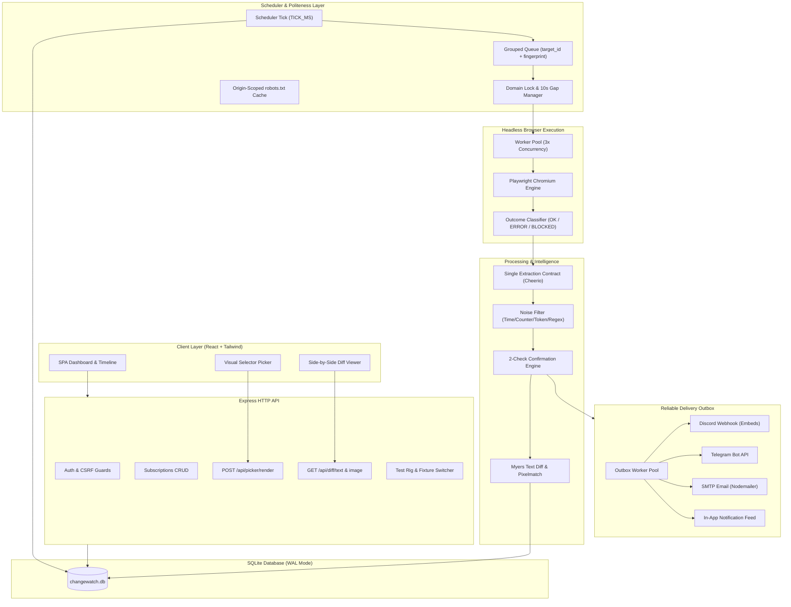

# ChangeWatch 👁️⚡

[](https://github.com/vaibhavmittal29/changewatch/actions/workflows/ci.yml)
[](https://github.com/vaibhavmittal29/changewatch/actions/workflows/deploy.yml)
[](./LICENSE)

> **Intelligent, Resilient Website Change Detector**  
> Headless browser monitoring with noise suppression, shared-fetch deduplication, and truthful multi-channel alerting.
>
> **Author:** [vaibhavmittal29](https://github.com/vaibhavmittal29) (Vaibhav Mittal) • **License:** [MIT](./LICENSE)

---

## 🌐 Live Demo & Deployment

- **Live Demo Website:** [https://vaibhavmittal29.github.io/changewatch/](https://vaibhavmittal29.github.io/changewatch/)
- **GitHub Repository:** [https://github.com/vaibhavmittal29/changewatch](https://github.com/vaibhavmittal29/changewatch)

> 💡 **Demo Access:** When visiting the live web demo, use the built-in **Autofill Demo** credentials (`demo@changewatch.local` / `Password123!`) to sign in and immediately explore the interactive dashboard, monitor timelines, visual selector picker, and Myers diff viewers.

---

## 📖 Project Overview

ChangeWatch monitors public web pages in a headless Playwright browser, isolates meaningful text and visual changes, filters out dynamic noise (clocks, counters, rotating ads, random tokens), and delivers alerts via Discord, Telegram, Email, and an in-app outbox. It **never** mistakes a 503 outage or CAPTCHA challenge for a content change, fetches a shared URL only once no matter how many users monitor it, and rigorously enforces site politeness (robots.txt, domain concurrency locks, and quiet periods).

---

## 🛠️ Tech Stack

- **Backend / API:** Node.js, TypeScript (Strict), Express 5
- **Headless Browser:** Playwright (Chromium)
- **DOM & Text Extraction:** Cheerio (Single Extraction Contract)
- **Diff Algorithms:** Myers Diff (`diff`), Pixelmatch visual diffing, PNGjs
- **Database:** SQLite via `better-sqlite3` (WAL mode, foreign keys enabled)
- **Frontend / UI:** React 19, TypeScript, Tailwind CSS, Vite (SPA served directly via Express middleware)
- **Validation & Crypto:** Zod (Strict schemas), Node.js `crypto` (PBKDF2, SHA-256, AES-256-GCM)
- **Networking & Politeness:** `ipaddr.js` (SSRF IP filter), `robots-parser`

---

## 💻 How to Run Locally

### 1. Prerequisites
- **Node.js LTS** (`>= 20.0.0`, Node v22/v24 recommended)
- **npm** (`>= 10.0.0`)
- **Git**

### 2. Quick Setup & Execution Commands
```bash
# Clone the repository
git clone https://github.com/vaibhavmittal29/changewatch.git
cd changewatch

# Install dependencies (clean install)
npm ci

# Install Playwright Chromium browser binaries
npx playwright install chromium

# Copy environment configuration
cp .env.example .env

# Initialize database schema and seed demo user
npm run seed

# Run the complete verification pipeline (typecheck, lint, 195 tests, build)
npm run verify

# Start development server (Express API + Vite React client with hot-reload)
npm run dev

# Or build for production and launch
npm run build
npm start
```

### 3. Core Commands Reference
| Command | Action |
|---|---|
| `npm run dev` | Start development server with hot-reloading (Express + Vite) |
| `npm run build` | Build production client bundle and compile TypeScript |
| `npm start` | Run production Express server |
| `npm run verify` | Run full quality gate pipeline (typecheck, lint, 195 tests, build) |
| `npm test` | Run all 38 Vitest unit and integration test suites |
| `npm run typecheck` | Run strict TypeScript compiler verification (`tsc --noEmit`) |
| `npm run lint` | Run ESLint zero-warning code quality check |
| `npm run smoke` | Run end-to-end smoke test suite on 16 local fixtures |
| `npm run benchmark` | Run 200-subscription shared-fetch scalability benchmark |

## 📁 Folder Structure

```text
changewatch/
├── src/
│   ├── client/                   # React 19 + Tailwind SPA
│   │   ├── components/           # Navbar, DiffViewer, PickerOverlay, StatusBadge, Modal
│   │   ├── pages/                # Dashboard, MonitorDetail, Compare, Picker, Settings, TestRig
│   │   ├── App.tsx & main.tsx    # Client routing & mounting
│   │   └── index.css             # Tailwind base styles
│   └── server/                   # Express 5 + Node.js API
│       ├── index.ts              # Server bootstrap & Vite middleware integration
│       ├── config.ts             # Zod environment variable parsing
│       ├── app.ts                # Express application definition
│       ├── auth/                 # PBKDF2 hashing, sessions, and CSRF token protection
│       ├── capture/              # Playwright capture, SSRF validator, Cheerio extraction, classifier
│       ├── db/                   # SQLite database connection, schema DDL, and migrations
│       ├── demo/                 # Local 16-fixture demo server (port 4000)
│       ├── diff/                 # Myers text diff & pixelmatch image diff engines
│       ├── engine/               # Normalization, sensitivity, confirmation state machine, versions
│       ├── notifications/        # Outbox worker, AES-256-GCM encryption, Discord/Telegram/Email
│       ├── queue/                # SQLite durable job queue, scheduler, and domain politeness
│       └── routes/               # API endpoints (auth, subscriptions, diff, picker, dashboard)
├── scripts/                      # CLI tools (seed, capture, smoke, benchmark, verify-ui)
├── tests/                        # Vitest test suites (unit & integration)
├── docs/                         # Technical documentation & interview guide
│   ├── implementation_plan.md    # Architecture specification & roadmap
│   ├── INTERVIEW_QA.md           # 20-question deep dive interview guide
│   └── evidence/                 # Visual test proof & benchmark outputs
├── package.json                  # Dependencies & npm scripts
├── tsconfig.json                 # Strict TypeScript configuration
└── vite.config.ts                # Vite frontend bundler config
```

---

## 🏗️ System Architecture



---

## 🎯 The Four Key Design Questions

### 1. Outage or CAPTCHA a change?
**No. Content changes and service disruptions are strictly isolated.**  
Every check is classified by the outcome engine as `OK`, `ERROR` (e.g. 503, 502, 404, network timeout), or `BLOCKED` (e.g. Cloudflare/reCAPTCHA challenges, 429 rate limit). Only `OK` checks are permitted to evaluate diffs or touch the baseline version history. Outages are tracked independently via `consecutive_failures`; after crossing the configured `OUTAGE_THRESHOLD` (default 3), a distinct `DOWN` alert is emitted. When the site recovers and returns an `OK` response, a `RECOVERED` alert is sent and the failure counter resets to zero.

### 2. 200 users monitoring the same URL?
**One fetch. Network overhead is consolidated through shared captures.**  
ChangeWatch decouples the concept of a **Target** (canonical URL and origin) from a **Subscription** (user alert rules, selectors, and sensitivity). When multiple users monitor the same URL with identical capture configurations, the scheduler groups all due subscriptions into **exactly one capture job** enforced by a database partial unique index (`uq_jobs_active_group`). The headless worker navigates to the page once, captures the sanitized DOM and screenshot, and records a single observation. The worker then evaluates each user's subscriptions in memory against that shared observation, applying individual selectors, noise filters, and sensitivity thresholds.

### 3. Pages that change on every load?
**Multi-layered defense suppresses false positives.**  
- **Tier 1 — CSS Selector Scoping**: The Visual Picker allows users to select exact target containers while ignoring dynamic widgets (e.g. banner ads, sidebars).
- **Tier 2 — Deterministic Normalization**: Regex-based normalizers strip dynamic timestamps, auto-incrementing view counters, and random hex/UUID session tokens.
- **Tier 3 — Sensitivity Threshold**: Diff line changes must cross user-defined thresholds (Myers diff line drift: `high`: any line added or removed, `balanced`: $\ge 5\%$ lines changed, `low`: $\ge 20\%$ lines changed).
- **Tier 4 — Two-Check Confirmation**: Unstable candidate changes must be observed across two consecutive checks before triggering an alert (`CONFIRM_DELAY_MS`).
- **Tier 5 — Alert Cooldown & Noisy Page Flagging**: Immediate alerts are throttled to once per 6 hours (suppressed events go to daily digests), and monitors triggering in >70% of checks are flagged `is_noisy`.

### 4. Not hammering sites (Politeness)?
**Rigorous origin-scoped rate limiting and respect for web standards.**  
- **Minimum Check Interval**: Enforced minimum of 15 minutes to 24 hours (with dev overrides restricted strictly to localhost demo origins).
- **Domain Locks & Quiet Periods**: At most one active browser navigation per domain at a time, followed by a mandatory 10-second quiet period (`DOMAIN_GAP_MS`).
- **Cached robots.txt**: Fetches and parses `robots.txt` per origin (separating HTTP and HTTPS), caching directives for 24 hours. `Disallow` rules immediately transition checks to `BLOCKED`.
- **Adaptive Jitter & Backoff**: Adds $\pm 10\%$ random jitter to scheduled checks to prevent synchronized traffic spikes, and honors HTTP 429 / `Retry-After` headers.

---

## ⚡ Quickstart & Setup

### Prerequisites
- **Node.js LTS** (`>= 20.0.0`, Node v24 tested)
- **npm** (`>= 10.0.0`)
- **Git**

### Installation

```bash
# 1. Clone the repository
git clone https://github.com/vaibhavmittal29/changewatch.git
cd changewatch

# 2. Install dependencies
npm install

# 3. Install Playwright Chromium browser binaries
npx playwright install chromium

# 4. Copy environment configuration
cp .env.example .env

# 5. Initialize SQLite schema & seed demo user
npm run seed
```

### Running the Application

```bash
# Development mode (starts Express API, background workers, demo fixtures, and Vite hot-reload)
npm run dev

# Or build for production and run
npm run build
npm start
```

Open `http://localhost:3000` in your browser.  
Default demo credentials (created by `npm run seed`):
- **Email**: `demo@changewatch.local`
- **Password**: `Password123!`

---

## 🚀 Quickstart & Deployment

- **Deployed Live URL:** `DEPLOYED_URL_HERE` *(configure in production with reverse proxy HTTPS)*
- **Local Dev Server:** `http://localhost:3000`
- **Demo Fixture Server:** `http://localhost:4000` (enabled via `ALLOW_LOCAL_DEMO=true`)

```bash
# 1. Install dependencies
npm ci

# 2. Run the all-in-one verification pipeline (typecheck, lint, 195 tests, build)
npm run verify

# 3. Start local development server (Express API + Vite React client)
npm run dev
```

---

## 🧪 Verification & Test Suites

ChangeWatch includes a comprehensive automated test and verification suite:

```bash
# Run the complete end-to-end verification battery (typecheck, lint, test, build)
npm run verify

# Run all 38 unit and integration test suites (195 automated tests)
npm test

# Run strict TypeScript typecheck
npm run typecheck

# Run ESLint zero-warning audit
npm run lint

# Production build (TypeScript bundling + Vite client build)
npm run build

# Run end-to-end smoke test on the 16 demo server fixtures
npm run smoke

# Run 200-subscription shared-fetch scalability benchmark
npm run benchmark
```

---

## ⚙️ Environment Configuration (`.env`)

| Variable | Default | Purpose |
|---|---|---|
| `PORT` | `3000` | Application HTTP server port |
| `BASE_URL` | `http://localhost:3000` | Fully-qualified public app URL |
| `APP_SECRET` | *(required)* | 32+ character random secret used for session hashing & AES-256 encryption |
| `DATABASE_PATH` | `./data/changewatch.db` | Filepath for the SQLite database |
| `CONTACT_EMAIL` | `student@vit.ac.in` | Included in the HTTP `User-Agent` header for web politeness |
| `PBKDF2_ITERATIONS` | `1000` (dev) / `600000` (prod)| Password hashing work factor |
| `TICK_MS` | `30000` | Scheduler polling interval (30 seconds) |
| `WORKER_CONCURRENCY`| `3` | Maximum number of concurrent browser navigation workers |
| `DOMAIN_GAP_MS` | `10000` | Mandatory quiet period between navigations to the same domain (10s) |
| `CONFIRM_DELAY_MS` | `120000` | Delay before fast candidate confirmation re-check (2 min) |
| `SHARED_CAPTURE_TTL_MS`| `15000` | Cache reuse window for identical target captures (15s) |
| `COOLDOWN_HOURS` | `6` | Minimum suppression window between immediate alerts for a monitor |
| `OUTAGE_THRESHOLD` | `3` | Consecutive failure count required before sending a DOWN alert |
| `ALLOW_LOCAL_DEMO` | `false` | Enables localhost/127.0.0.1 demo fixture server and Test Rig |
| `DEMO_PORT` | `4000` | Port for the local 16-fixture demo server |

---

## 🔒 Security & Egress Defense

ChangeWatch operates under a zero-trust model for arbitrary URLs:

1. **SSRF Guard (`validateUrl.ts`)**: Every submitted URL and subsequent HTTP redirect is parsed and validated using `ipaddr.js`. Loops back, link-local, RFC-1918 private subnets, cloud metadata addresses (`169.254.169.254`), and IPv4-mapped IPv6 ranges are rejected immediately.
2. **Browser Interception (`playwrightCapture.ts`)**: Headless Chromium contexts block all `media`, `font`, and excessive asset requests. Service workers are unregistered and blocked (`serviceWorkers: 'block'`), and WebSocket handshakes are explicitly closed via `page.routeWebSocket()`.
3. **Encrypted Credentials**: Webhook URLs, Telegram bot tokens, and SMTP credentials are encrypted with AES-256-GCM prior to database storage. Endpoints only return masked strings (e.g. `••••••••3a1f`).
4. **Strict Capture Configurations**: Canonical JSON serialization ensures deterministic SHA-256 fingerprints. Any unauthorized headers (`Authorization`, `Cookie`) are rejected by strict Zod schema validation.

---

## ⚠️ Known Limitations & Engineering Tradeoffs

- **Browser DNS Pinning**: Node.js does not have socket-level control over Chromium's internal DNS resolution. While initial requests are IP-pinned via `safeFetch`, browser-level DNS rebinding is mitigated by per-request route validation and deployment-level egress firewall rules (`iptables`).
- **Single-Writer SQLite**: SQLite in WAL mode delivers sub-millisecond read performance and concurrency for single-server deployments. For multi-node cluster scaling, the job queue and storage can be migrated to PostgreSQL with row-level locking (`FOR UPDATE SKIP LOCKED`).
- **Complex Dynamic Animations**: Pixel-based screenshot diffs can produce false positives on canvas animations or WebGL. ChangeWatch treats normalized text diffs as the primary source of truth, using screenshot diffs as visual confirmation.

---

## 🎬 3-Minute Demo Walkthrough Script

### Minute 1: The Problem & The Test Rig
- Open `http://localhost:3000/demo/rig`.
- Show the 16 demo fixtures: stable pages, live clocks, visit counters, 503 outages, and fake CAPTCHAs.
- Explain: *"Traditional uptime monitors trigger false alerts whenever a clock ticks or an ad rotates. ChangeWatch eliminates this noise."*

### Minute 2: Visual Selector Picker & Change Detection
- Go to **Dashboard** $\to$ **Add Monitor** $\to$ Select `/demo/headline`.
- Click **Launch Picker ↗**. Show the high-resolution overlay canvas.
- Hover over the `#headline` element, click it, and assign **"Watch this element"** (emerald).
- Click **"Test Selectors"**: show the live Cheerio extraction preview matching the background worker.
- Trigger an edit on `/demo/headline`. Show the Dashboard transition: `OK` $\to$ `CHECKING` $\to$ `CHANGED`.

### Minute 3: Diff Comparison & Alert Outbox
- Click into the monitor's **Timeline**: show Version 1 (Baseline) and Version 2 (Confirmed Change).
- Click **Compare Versions**:
  - Show the **Unified Text Diff**: added lines highlighted in green, removed in red, with word-level inline precision.
  - Show the **Screenshot Diff**: pixelmatch visual diff highlighting changed regions in red with percentage change metrics.
- Open **Settings** $\to$ **Notifications**: show the truthful outbox log recording delivery status states (`SENT_EXTERNAL`, `RECORDED_IN_APP`).
- Conclude: *"All 200 monitors on this URL were evaluated using a single shared browser capture, drastically reducing duplicate network traffic."*

---

## 📸 Evidence & Visual Gallery

All phases are backed by automated verification logs and screenshots under [`docs/evidence/`](./docs/evidence/):

- [`docs/evidence/phase-1/`](./docs/evidence/phase-1/): Authentication, Session tokens, CSRF protection, and Login UI.
- [`docs/evidence/phase-2/`](./docs/evidence/phase-2/): Playwright capture, route filtering, and fixture classification.
- [`docs/evidence/phase-6/compare-unified.png`](./docs/evidence/phase-6/compare-unified.png): Unified Myers text diff and pixelmatch visual diff viewer.
- [`docs/evidence/phase-8/dashboard.png`](./docs/evidence/phase-8/dashboard.png): Real-time monitor list with badges, search, and quick actions.
- [`docs/evidence/phase-8/monitor-detail-timeline.png`](./docs/evidence/phase-8/monitor-detail-timeline.png): Version timeline, check runs, and audit logs.
- [`docs/evidence/phase-9/picker-popover.png`](./docs/evidence/phase-9/picker-popover.png): Interactive canvas overlay with Watch/Ignore popover actions.
- [`docs/evidence/phase-10/benchmark-results.txt`](./docs/evidence/phase-10/benchmark-results.txt): 200-subscription scalability benchmark output log.
- [`docs/evidence/phase-10/smoke-results.txt`](./docs/evidence/phase-10/smoke-results.txt): End-to-end smoke test suite output log.

---

## 📜 License & Author

- **Author:** [vaibhavmittal29](https://github.com/vaibhavmittal29) (Vaibhav Mittal — `vaibhavmittalwork@gmail.com`)
- **License:** [MIT License](./LICENSE)
