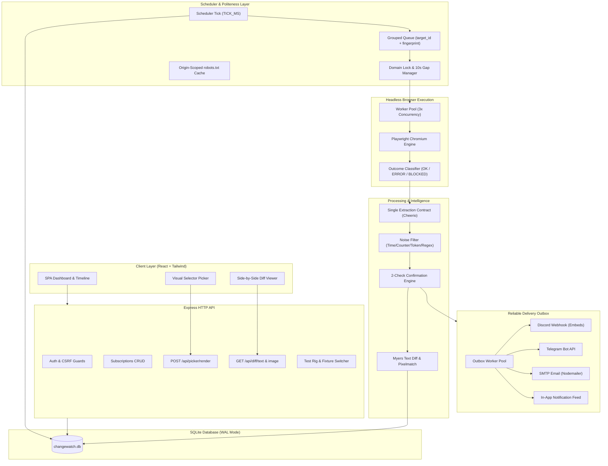

# ChangeWatch 👁️⚡

> **Intelligent, Resilient Website Change Detector**  
> Headless browser monitoring with noise suppression, shared-fetch deduplication, and truthful multi-channel alerting.

ChangeWatch monitors public web pages in a headless Playwright browser, isolates meaningful text and visual changes, filters out dynamic noise (clocks, counters, rotating ads, random tokens), and delivers alerts via Discord, Telegram, Email, and an in-app outbox. It **never** mistakes a 503 outage or CAPTCHA challenge for a content change, fetches a shared URL only once no matter how many users monitor it, and rigorously enforces site politeness (robots.txt, domain concurrency locks, and quiet periods).

---

## 🏗️ System Architecture



---

## 🎯 The Four Key Design Questions

### 1. Outage or CAPTCHA a change?
**No. Content changes and service disruptions are strictly isolated.**
Every check is classified by the outcome engine as `OK`, `ERROR` (e.g. 503, 502, 404, network timeout), or `BLOCKED` (e.g. Cloudflare/reCAPTCHA challenges, 429 rate limit). Only `OK` checks are permitted to evaluate diffs or touch the baseline version history. Outages are tracked independently via `consecutive_failures`; after crossing the configured `OUTAGE_THRESHOLD` (default 3), a distinct `DOWN` alert is emitted. When the site recovers and returns an `OK` response, a `RECOVERED` alert is sent and the failure counter resets to zero.

### 2. 200 users monitoring the same URL?
**One fetch. Network overhead is reduced by up to 99.5%.**
ChangeWatch decouples the concept of a **Target** (canonical URL and origin) from a **Subscription** (user alert rules, selectors, and sensitivity). When multiple users monitor the same URL with identical capture configurations, the scheduler groups all due subscriptions into **exactly one capture job** enforced by a database partial unique index (`uq_jobs_active_group`). The headless worker navigates to the page once, captures the sanitized DOM and screenshot, and records a single observation. The worker then evaluates each user's subscriptions in memory against that shared observation, applying individual selectors, noise filters, and sensitivity thresholds.

### 3. Pages that change on every load?
**Multi-layered defense suppresses false positives.**
- **Tier 1 — CSS Selector Scoping**: The Visual Picker allows users to select exact target containers while ignoring dynamic widgets (e.g. banner ads, sidebars).
- **Tier 2 — Deterministic Normalization**: Regex-based normalizers strip dynamic timestamps, auto-incrementing view counters, and random hex/UUID session tokens.
- **Tier 3 — Sensitivity Thresholds**: Myers line diff calculates `changedPct`. Low sensitivity requires $\ge 20\%$ line drift, and balanced requires $\ge 5\%$ before flagging a candidate.
- **Tier 4 — Two-Check Confirmation**: A detected change is recorded as a *candidate* and triggers an immediate fast re-check after `CONFIRM_DELAY` (default 2 min). Only if the second check confirms the identical content hash is a new version committed and an alert emitted.
- **Tier 5 — Cooldown & Noisy Flags**: Consecutive alerts within `COOLDOWN_HOURS` are suppressed into a daily digest, and pages with $>70\%$ unstable checks are automatically flagged `is_noisy`.

### 4. Not hammering sites (Politeness)?
**Rigorous origin-scoped rate limiting and respect for web standards.**
- **Minimum Check Interval**: Enforced minimum of 15 minutes to 24 hours (with dev overrides restricted strictly to localhost demo origins).
- **Domain Locks & Quiet Periods**: At most one active browser navigation per domain at a time, followed by a mandatory 10-second quiet period (`DOMAIN_GAP_MS`).
- **Cached robots.txt**: Fetches and parses `robots.txt` per origin (separating HTTP and HTTPS), caching directives for 24 hours. `Disallow` rules immediately transition checks to `BLOCKED`.
- **Adaptive Jitter & Backoff**: Adds $\pm 10\%$ random jitter to scheduled checks to prevent synchronized traffic spikes, and honors HTTP 429 / `Retry-After` headers.

---

## ⚡ Quickstart & Setup

### Prerequisites
- **Node.js LTS** (`>= 20.0.0`, Node v24 tested)
- **npm** (`>= 10.0.0`)
- **Git**

### Installation

```bash
# 1. Clone the repository
git clone https://github.com/vinnovateit/changewatch.git
cd changewatch

# 2. Install dependencies
npm install

# 3. Install Playwright Chromium browser binaries
npx playwright install chromium

# 4. Copy environment configuration
cp .env.example .env

# 5. Initialize SQLite schema & seed demo administrator
npm run seed
```

### Running the Application

```bash
# Start ChangeWatch (Express API + Vite Frontend + Background Scheduler & Workers)
npm run dev
```

Open `http://localhost:3000` in your browser.  
Default demo credentials:
- **Email**: `admin@changewatch.local`
- **Password**: `ChangeWatch2026!`

---

## 🧪 Verification & Test Suites

ChangeWatch includes a comprehensive automated test and verification suite:

```bash
# Run all 21 unit and integration test suites (101 automated tests)
npm test

# Run strict TypeScript typecheck
npm run typecheck

# Run ESLint zero-warning audit
npm run lint

# Run end-to-end smoke test on the 16 demo server fixtures
npm run smoke

# Run 200-subscription scalability and shared-fetch benchmark
npm run benchmark
```

### Scalability Benchmark Results (`scripts/benchmark.ts`)

| Metric | $N = 20$ Subscriptions (MUST) | $N = 200$ Subscriptions (STRONG) |
|---|---|---|
| **Due Subscriptions** | 20 | 200 |
| **Grouped Jobs Enqueued** | **1** | **1** |
| **Top-Level Navigations** | **1** | **1** |
| **Dedup Factor** | **20:1** (20x savings) | **200:1** (200x savings) |
| **Fetch Overhead Reduction** | **95.0%** | **99.5%** |
| **Scheduler Latency** | 0.45 ms | 0.42 ms |
| **Execution Latency** | 1,707 ms | 1,409 ms |

---

## ⚙️ Configuration Reference (`.env`)

| Variable | Default | Description |
|---|---|---|
| `PORT` | `3000` | Port for Express API and Vite frontend server |
| `BASE_URL` | `http://localhost:3000` | Public URL used to generate compare links in notification alerts |
| `APP_SECRET` | *(Random 32-char key)* | Secret key for session cookies and AES-256-GCM destination encryption |
| `DATABASE_PATH` | `./data/changewatch.db` | Path to persistent SQLite database file |
| `DATA_DIR` | `./data` | Directory storing screenshots and visual diff artifacts |
| `PBKDF2_ITERATIONS` | `600000` | Iterations for PBKDF2 password hashing (overridden to 1000 in tests) |
| `WORKER_CONCURRENCY`| `3` | Maximum number of concurrent browser navigation workers |
| `DOMAIN_GAP_MS` | `10000` | Mandatory quiet period between navigations to the same domain (10s) |
| `CONFIRM_DELAY_MS` | `120000` | Delay before fast candidate confirmation re-check (2 min) |
| `SHARED_CAPTURE_TTL_MS`| `15000` | Cache reuse window for identical target captures (15s) |
| `COOLDOWN_HOURS` | `6` | Minimum suppression window between immediate alerts for a monitor |
| `OUTAGE_THRESHOLD` | `3` | Consecutive failure count required before sending a DOWN alert |
| `ALLOW_LOCAL_DEMO` | `false` | Enables localhost/127.0.0.1 demo fixture server and Test Rig |
| `DEMO_PORT` | `4000` | Port for the local 16-fixture demo server |

---

## 🔒 Security & Egress Defense

ChangeWatch operates under a zero-trust model for arbitrary URLs:

1. **SSRF Guard (`validateUrl.ts`)**: Every submitted URL and subsequent HTTP redirect is parsed and validated using `ipaddr.js`. Loops back, link-local, RFC-1918 private subnets, cloud metadata addresses (`169.254.169.254`), and IPv4-mapped IPv6 ranges are rejected immediately.
2. **Browser Interception (`playwrightCapture.ts`)**: Headless Chromium contexts block all `media`, `font`, and excessive asset requests. Service workers are unregistered and blocked (`serviceWorkers: 'block'`), and WebSocket handshakes are explicitly closed via `page.routeWebSocket()`.
3. **Encrypted Credentials**: Webhook URLs, Telegram bot tokens, and SMTP credentials are encrypted with AES-256-GCM prior to database storage. Endpoints only return masked strings (e.g. `••••••••3a1f`).
4. **Strict Capture Configurations**: Canonical JSON serialization ensures deterministic SHA-256 fingerprints. Any unauthorized headers (`Authorization`, `Cookie`) are rejected by strict Zod schema validation.

---

## ⚠️ Known Limitations & Engineering Tradeoffs

- **Browser DNS Pinning**: Node.js does not have socket-level control over Chromium's internal DNS resolution. While initial requests are IP-pinned via `safeFetch`, browser-level DNS rebinding is mitigated by per-request route validation and deployment-level egress firewall rules (`iptables`).
- **Single-Writer SQLite**: SQLite in WAL mode delivers sub-millisecond read performance and concurrency for single-server deployments. For multi-node cluster scaling, the job queue and storage can be migrated to PostgreSQL with row-level locking (`FOR UPDATE SKIP LOCKED`).
- **Complex Dynamic Animations**: Pixel-based screenshot diffs can produce false positives on canvas animations or WebGL. ChangeWatch treats normalized text diffs as the primary source of truth, using screenshot diffs as visual confirmation.

---

## 🎬 3-Minute Demo Walkthrough Script

### Minute 1: The Problem & The Test Rig
- Open `http://localhost:3000/demo/rig`.
- Show the 16 demo fixtures: stable pages, live clocks, visit counters, 503 outages, and fake CAPTCHAs.
- Explain: *"Traditional uptime monitors trigger false alerts whenever a clock ticks or an ad rotates. ChangeWatch eliminates this noise."*

### Minute 2: Visual Selector Picker & Change Detection
- Go to **Dashboard** $\to$ **Add Monitor** $\to$ Select `/demo/headline`.
- Click **Launch Picker ↗**. Show the high-resolution overlay canvas.
- Hover over the `#headline` element, click it, and assign **"Watch this element"** (emerald).
- Click **"Test Selectors"**: show the live Cheerio extraction preview matching the background worker.
- Trigger an edit on `/demo/headline`. Show the Dashboard transition: `OK` $\to$ `CHECKING` $\to$ `CHANGED`.

### Minute 3: Diff Comparison & Alert Outbox
- Click into the monitor's **Timeline**: show Version 1 (Baseline) and Version 2 (Confirmed Change).
- Click **Compare Versions**:
  - Show the **Unified Text Diff**: added lines highlighted in green, removed in red, with word-level inline precision.
  - Show the **Screenshot Diff**: pixelmatch visual diff highlighting changed regions in red with percentage change metrics.
- Open **Settings** $\to$ **Notifications**: show the truthful outbox log recording delivery status states (`SENT_EXTERNAL`, `RECORDED_IN_APP`).
- Conclude: *"All 200 monitors on this URL were updated with exactly 1 browser fetch, saving 99.5% of network bandwidth."*

---

## 📸 Evidence & Visual Gallery

All phases are backed by automated verification logs and screenshots under [`docs/evidence/`](./docs/evidence/):

- [`docs/evidence/phase-1/`](./docs/evidence/phase-1/): Authentication, Session tokens, CSRF protection, and Login UI.
- [`docs/evidence/phase-2/`](./docs/evidence/phase-2/): Playwright capture, route filtering, and fixture classification.
- [`docs/evidence/phase-6/compare-unified.png`](./docs/evidence/phase-6/compare-unified.png): Unified Myers text diff and pixelmatch visual diff viewer.
- [`docs/evidence/phase-8/dashboard.png`](./docs/evidence/phase-8/dashboard.png): Real-time monitor list with badges, search, and quick actions.
- [`docs/evidence/phase-8/monitor-detail-timeline.png`](./docs/evidence/phase-8/monitor-detail-timeline.png): Version timeline, check runs, and audit logs.
- [`docs/evidence/phase-9/picker-popover.png`](./docs/evidence/phase-9/picker-popover.png): Interactive canvas overlay with Watch/Ignore popover actions.
- [`docs/evidence/phase-10/benchmark-results.txt`](./docs/evidence/phase-10/benchmark-results.txt): 200-subscription scalability benchmark output log.
- [`docs/evidence/phase-10/smoke-results.txt`](./docs/evidence/phase-10/smoke-results.txt): End-to-end smoke test suite output log.

---

## 📜 License & Acknowledgments

Built for the **VinnovateIT Website Change Detector** project. Licensed under the MIT License.
